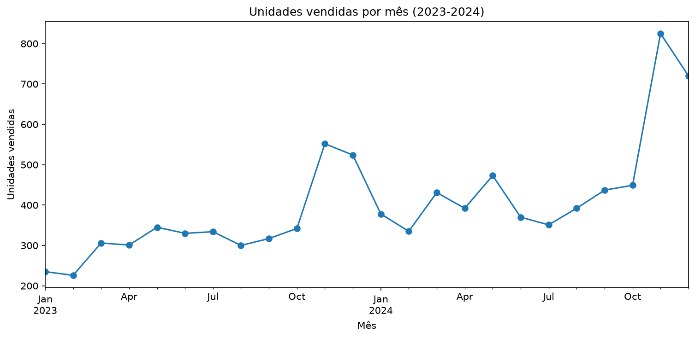
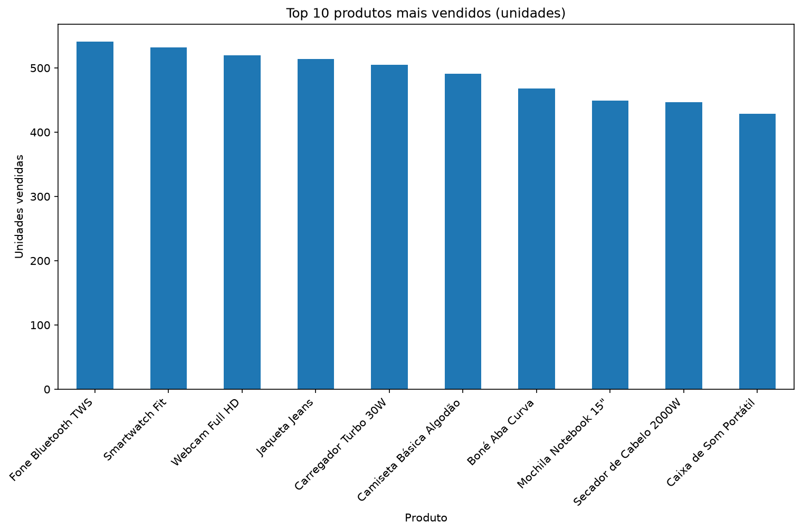
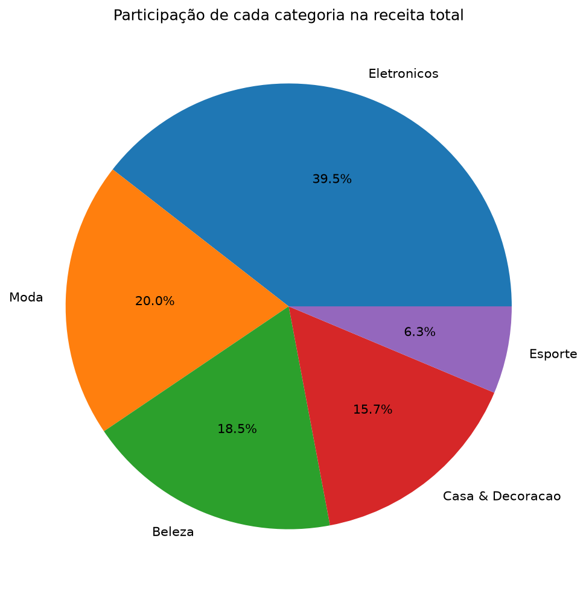
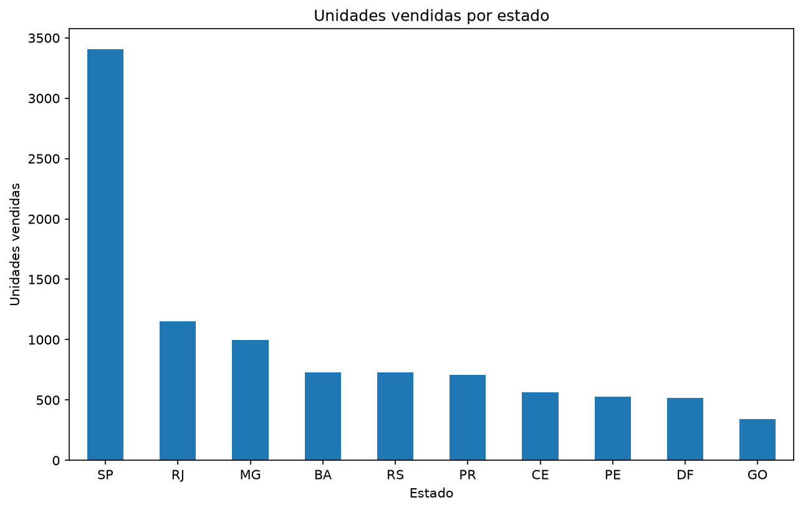

# Análise de Pedidos de uma Loja Online

Análise exploratória em Python (pandas) em relação a uma base de pedidos de loja online, 24 meses (Jan/2023-Dez/2024). Fluxo completo: diagnostico de qualidade dos dados, limpeza, perguntas de negócio, visualização e conclusões.

> **Sobre os dados:** a base é **sintética**, gerada pelo Claude, para estudo e com problemas de qualidade inseridos de propósito (formatos de data misturados, texto sem padronização, duplicatas, nulos e valores impossíveis). Os números não representam nenhuma empresa real.

**Resumo da base:** 5.118 linhas brutas → 4.871 pedidos válidos após a limpeza · 24 produtos · 5 categorias · 10 estados · 3 canais de venda.

## Principais achados

- **Eletrônicos é o motor da loja:** 39,5% da receita e líder em unidades vendidas, receita e ticket médio (R$ 325).
- **Esporte é a categoria mais fraca em quase todos os recortes:** menor volume e receita (6,3% do total), taxa de cancelamento levemente acima das demais (8,7% contra 7,9% geral) e produtos entre os piores por estado, por canal e por mês.
- **Volume e receita contam histórias diferentes:** o Smartwatch Fit é o 2º em unidades e o 1º em receita, com receita cerca de 2x a do 2º colocado (Perfume Importado).
- **Crescimento e sazonalidade:** 2024 vendeu cerca de 35% mais unidades que 2023. Novembro e dezembro são os picos (Black Friday/Natal) e fevereiro é o mês mais fraco nos dois anos.
- **Concentração geográfica:** São Paulo responde por cerca de 35% das unidades e supera a soma dos três estados seguintes (RJ, MG e BA). O ticket médio é parecido entre estados (R$ 200 a R$ 222), então a diferença vem do volume.
- **Canais:** o site lidera em volume e receita. O marketplace vende menos, mas tem o maior ticket médio (R$ 222,59), uma hipótese a investigar.

## Perguntas respondidas

**Núcleo**
1. Quais produtos vendem mais e menos (em unidades e em receita)?
2. Quais categorias vendem mais e menos?
3. Qual a taxa geral de cancelamento e quais categorias cancelam mais e menos?
4. Quais estados compram mais e menos?
5. Qual canal vende mais e menos?
6. Como as vendas evoluem mês a mês?

**Avançado (cruzamentos com `pivot_table`)**

7. Quais produtos vendem mais e menos em cada estado?
8. Quais produtos vendem mais e menos em cada canal?
9. Quais produtos vendem mais e menos no mês de pico (nov/2024) e no mês de vale (fev/2023)?

## Gráficos









## Limpeza dos dados

| Problema encontrado | Tratamento |
|---|---|
| `frete` lido como texto (`"R$ 28,06"`) | Remoção do `R$` e troca de vírgula por ponto, conversão para `float` |
| 118 linhas duplicadas | `drop_duplicates()` |
| Texto inconsistente em cidade, categoria e status (caixa, espaços, acentos) | `strip`, `title` e remoção de acentos |
| 45 pedidos com quantidade ≤ 0 | Removidos e salvos em `quantidade_invalida_revisar.csv` |
| Nulos em `estado` e `cidade` | Recuperados por relação (cidade → estado; estado → cidade quando só há uma cidade no estado) |
| Nulos em `categoria` | Recuperados a partir do produto (cada produto pertence a uma única categoria) |
| 84 pedidos sem preço ou com cidade irrecuperável (estado de SP, ambíguo) | Removidos e salvos em `cidade_preco_invalido_revisar.csv` |
| Datas em dois formatos (`AAAA-MM-DD` e `DD/MM/AAAA`) | Convertidas em duas tentativas com `pd.to_datetime` |
| Nulos em `data_entrega` | Mantidos: correspondem a pedidos cancelados ou em transporte |

## Limitações

- A base é sintética: os padrões valem para este conjunto, não para o mercado real.
- A análise descreve o que aconteceu, mas não testa causas. Por que Esporte vende menos (preço, catálogo, demanda) exigiria dados adicionais.
- Volume por estado não é poder de compra por pessoa: não há dados de população nem de clientes únicos.
- O mês de vale (fev/2023) tem só 226 unidades vendidas, então diferenças entre produtos ali têm mais ruído.
- `idxmax` e `idxmin` mostram só o primeiro e o último colocado, sem a magnitude da diferença.
- Os pedidos removidos ficam em CSVs separados para revisão e não entram nos cálculos.

## Tecnologias

Python 3.14 · pandas · matplotlib · Jupyter · Git/GitHub · VS Code

## Como rodar

```bash
git clone https://github.com/luizolavoremy/analise-pedidos-loja.git
cd analise-pedidos-loja
python -m venv venv
venv\Scripts\activate        # Windows (Mac/Linux: source venv/bin/activate)
pip install -r requirements.txt
```

Depois, abra `analise_pedidos.ipynb` no VS Code (com a extensão Jupyter) selecionando o kernel do `venv`, ou rode `jupyter notebook`.

## Estrutura do repositório

```
analise-pedidos-loja/
├── analise_pedidos.ipynb              # notebook com toda a análise
├── pedidos_loja.csv                   # base original (suja)
├── quantidade_invalida_revisar.csv    # pedidos removidos: quantidade <= 0
├── cidade_preco_invalido_revisar.csv  # pedidos removidos: cidade/preço ausente
├── imagens/                           # gráficos usados neste README
├── requirements.txt
└── README.md
```

## Próximos passos

- Refazer as mesmas perguntas em SQL.
- Montar um dashboard em Power BI sobre os dados já limpos.

## Autor

Luiz Olavo Remy Firmino · https://linkedin.com/in/luiz-olavo-remy · luiz.olavo.remy@gmail.com
